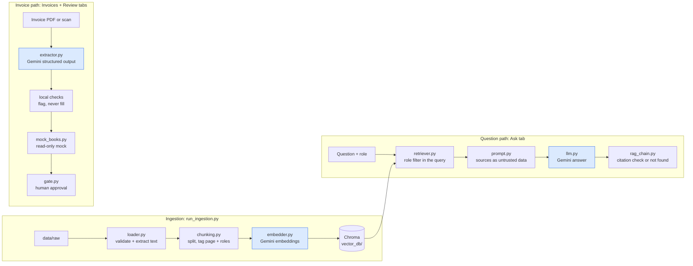

# PrivateDesk

A private document and invoice assistant for a small business, built as a three-day prototype.

- **Ask** questions about company documents and get answers with the source passage shown.
- **Refuse** to answer ("not found") when the documents do not support an answer.
- **Extract** invoice fields into a table, with uncertain fields flagged for review instead of guessed.
- **Compare** extracted invoices with a mock accounting system and draft follow-ups that a person must approve.

All data in this repository is synthetic. The company, people, suppliers and figures are invented.

> Prototype status: built and tested on one Windows laptop. It is not production software. It uses a cloud AI provider (Google Gemini) for speed; the provider layer is built so embeddings and answers can move to local models, but that has not been tested.

## Contents

- [How it works](#how-it-works)
- [What leaves the machine](#what-leaves-the-machine)
- [Security controls](#security-controls)
- [Quick start](#quick-start)
- [Evaluation results](#evaluation-results)
- [Experiments](#experiments)
- [Configuration](#configuration)
- [Project structure](#project-structure)
- [Known limitations](#known-limitations)

## How it works

Three pipelines. Only the highlighted steps call the AI provider; everything else runs locally.



**Answers.** The retriever applies the user's role as a filter inside the Chroma query, so passages the role may not see never reach the prompt. Retrieved passages go into a delimited data block that the model is told never to treat as instructions. The model returns structured output (`found`, `answer`, `citations`). The app shows an answer only if the model cites passages it was actually given; otherwise the answer is "not found".

**Invoices.** The model extracts supplier, date, invoice number, amount and currency, each with a confidence level and the exact text it read the value from. Local checks then decide whether to trust each field: the quoted text must appear in the document, dates that could be read two ways are flagged, a bare `$` is flagged, numbers that only appear next to words like "previous" or "PO" are flagged, and the amount must match the printed total. Any field that fails is left empty and marked for review.

**Approvals.** Follow-ups (a query email, a "create bill" change) are drafted from fixed templates, never by the model. Nothing happens until a named person clicks Approve, and approval only writes the action to a local outbox file. Nothing is sent and the mock books are never modified.

**Activity log.** Every question, extraction, comparison, approval and access change is written to a local SQLite log, with document names but never document text.

## What leaves the machine

| Data | Destination | When |
|---|---|---|
| Document text, in chunks | Gemini embedding API | Once, at ingestion |
| Each question | Gemini embedding API and chat model | Every question |
| Up to 5 retrieved passages the user's role may see | Gemini chat model | Every question that passes the relevance cut-off |
| Invoice text, or page images for scans | Gemini chat model | Each extraction |
| Vector index and chunk text (`vector_db/`, `data/processed/`) | Stays local | |
| Role rules (`data/manifest.json`) | Stays local | |
| Activity log, approvals, outbox (`logs/`) | Stays local | |
| Mock accounting data (`data/accounting/`) | Stays local | |

Check Google's current Gemini API terms before using real data. At the time of writing, content sent through the free tier may be used to improve Google's products, while the paid tier excludes it. This prototype was only run on synthetic data.

## Security controls

| Risk | Control | Where | Tested by |
|---|---|---|---|
| Prompt injection from documents | Retrieved text is a delimited data block; tags inside documents are neutralised; model output is shown as plain text; no action runs without a human | `prompt.py`, `main.py`, `gate.py` | `test_injected_document_text_stays_inside_the_data_block`, `test_model_output_cannot_render_markdown_images`, security cases s01 and s02 |
| Role leak | Role filter inside the Chroma query; the retriever refuses results for the wrong role; reranking happens after filtering | `retriever.py` | `test_finance_user_never_receives_an_hr_chunk`, cross-role sweep (0 leaks) |
| Leaked secrets | Keys only in `.env` (gitignored); API errors reduced to type and status code; keys redacted from the log | `config.py`, `helpers.py`, `logger.py` | `test_*_errors_do_not_expose_api_details`, `test_secrets_are_redacted_from_the_log` |
| Sensitive data in logs | Log stores user, role, question, document names and outcomes, never chunk text, answers or email bodies | `logger.py` | `test_questions_are_logged_with_document_names_not_text` |
| Malicious files | Allow-list of PDF, text, CSV and image types; size and page limits; file content must match its extension; nothing is executed | `loader.py` | `test_unsupported_file_type_is_rejected` and four related tests |
| Cost abuse | Output-token caps per answer and per extraction; 10 questions per user per minute | `llm.py`, `config.py` | `test_rate_limiter_throttles_a_burst_per_user` |
| Data at rest | `vector_db/`, `data/processed/` and `logs/` are gitignored; use full-disk encryption | `.gitignore` | Folders untracked |
| Unauthorised actions | Only a named person can approve; accounting changes need the Finance role and a live connection; "Revoke access" disables the mock accounting connection | `gate.py`, `mock_books.py` | `test_only_a_named_person_can_approve`, `test_accounting_changes_need_finance_and_a_live_connection` |

## Quick start

Requires Python 3.12 and a Gemini API key.

```bash
python -m venv venv
venv\Scripts\activate            # Windows
source venv/bin/activate         # macOS / Linux
pip install -r requirements.txt

copy .env.example .env           # Windows (macOS / Linux: cp .env.example .env)
                                 # then put your key in GEMINI_API_KEY
python run_ingestion.py          # index the build documents
streamlit run app/main.py        # open http://localhost:8501
```

Other commands:

```bash
pytest                                                # 124 offline tests, no API calls
python scripts/generate_data.py                       # regenerate the synthetic data
python -m app.evaluation.evaluator --report           # build-set report
python run_ingestion.py --include-holdout             # then the held-out report:
python -m app.evaluation.evaluator --report --holdout
python -m app.generation.rag_chain "What are the Bluestone payment terms?" --role finance
python -m app.extraction.extractor
```

In the app, pick a role in the sidebar. Finance sees contracts, the price list, invoices and the bank statement. HR sees the leave policy. Both see the expense policy, status notes and meeting notes. The demo user name is typed in the sidebar; there is no login.

## Evaluation results

Full tables, with every question and answer: [reports/evaluation_results.md](reports/evaluation_results.md). Run on 2026-10-25 with `gemini-embedding-2` and `gemini-3.8-flash`.

| Measure | Build set (used while developing) | Held-out set (never used while developing) |
|---|---|---|
| Right passage ranked first | 10/10 | 5/5 |
| Answered and cited the expected source | 10/10 | 5/5 |
| Correctly answered "not found" | 5/5 | 1/1 |
| Role leaks (assigned role / cross-role sweep) | 0 / 0 | 0 / 0 |
| Security cases (injection, fake bank change, role bypass) | 3/3 | not run |
| Invoice fields correct, 3 runs | 20/20 each run | 10/10 each run |
| Messy invoice flagged, not filled | 3 of 3 runs | no messy invoice in this set |
| Books comparison as expected | 4/4 each run | 2/2 each run |

The five "not found" questions include two that the role filter must block (a Finance user asking about parental leave, an HR user asking about a Finance-only contract) and a near-miss (Q3 revenue, when only Q2 revenue is in the documents).

## Experiments

[notebooks/experiments.ipynb](notebooks/experiments.ipynb) compares chunk sizes and the optional local reranker on retrieval:

| Chunk size | Chunks | Reranker | hit@1 | hit@3 |
|---|---|---|---|---|
| 500 | 61 | none | 1.0 | 1.0 |
| 500 | 61 | lexical | 0.9 | 1.0 |
| **900** | **37** | **none** | **1.0** | **1.0** |
| 900 | 37 | lexical | 0.9 | 1.0 |
| 1400 | 22 | none | 0.9 | 1.0 |
| 1400 | 22 | lexical | 0.7 | 1.0 |

The app keeps 900-character chunks with no reranker. The lexical (BM25) reranker lowered the scores, so under the rule of keeping a change only if the score rises, it stays off. In every configuration some unanswerable questions scored as high as answerable ones, so a relevance threshold alone cannot decide "not found". That job is left to the grounded prompt and the citation check.

## Configuration

Settings live in `.env` (see `.env.example`).

| Variable | Default | Purpose |
|---|---|---|
| `AI_PROVIDER` | `gemini` | `gemini` or `openai` for both embeddings and answers |
| `GEMINI_API_KEY` / `OPENAI_API_KEY` | | API keys, never committed |
| `GEMINI_CHAT_MODEL`, `GEMINI_EMBEDDING_MODEL`, `GEMINI_EXTRACTION_MODEL` | `gemini-3.8-flash`, `gemini-embedding-2`, `gemini-3.8-flash` | Model names per provider (`OPENAI_*` equivalents exist) |
| `EMBEDDING_DIMENSIONS` | `768` | Embedding size; changing it needs re-ingestion |
| `CHUNK_SIZE` / `CHUNK_OVERLAP` | `900` / `150` | Characters per chunk |
| `TOP_K` | `5` | Passages retrieved per question |
| `MIN_RELEVANCE` | `0.55` | Below this, answer "not found" without calling the model |
| `RERANKER` | `none` | `lexical` enables the local BM25 reranker |
| `CHAT_REASONING_EFFORT` / `EXTRACTION_REASONING_EFFORT` | `low` / `medium` | Model thinking level |
| `MAX_ANSWER_TOKENS` / `MAX_EXTRACTION_TOKENS` | `1500` / `8000` | Output caps (thinking counts towards them) |
| `QUESTIONS_PER_MINUTE` | `10` | Per-user rate limit |

Switching provider or embedding model needs `python run_ingestion.py` again; the retriever refuses an index built with a different model.

## Project structure

```
app/
  main.py                    Streamlit UI: Ask, Invoices, Review tabs
  config.py                  settings from .env
  ingestion/                 loader.py, chunking.py, embedder.py
  retrieval/                 vector_store.py, retriever.py, reranker.py
  generation/                llm.py, prompt.py, rag_chain.py
  extraction/                schemas.py, extractor.py
  accounting/mock_books.py   read-only mock QuickBooks data and comparison
  approvals/gate.py          drafted actions wait for a human
  evaluation/                metrics.py, evaluator.py, report.py
  utils/                     logger.py (SQLite activity log), helpers.py
data/
  raw/                       build documents, invoices, bank statement
  holdout/                   held-out documents and invoices
  eval/                      questions and ground truth
  accounting/                mock QuickBooks JSON
  manifest.json              role rules per document
notebooks/experiments.ipynb  chunk size and reranker experiments
reports/                     saved evaluation results
scripts/generate_data.py     synthetic data generator
tests/                       offline tests with fake models (pytest)
run_ingestion.py             load, chunk, embed and index
```

## Known limitations

- **Three-day prototype**, tested on one Windows laptop with synthetic data. Not tested on macOS or a Mac Studio.
- **Cloud AI provider.** Document text, questions and invoices are sent to Gemini. Moving embeddings and answers to local models is designed for but not implemented or tested.
- **Mock accounting.** The QuickBooks connection is a local read-only JSON mock. Approved actions are simulated in a local outbox; nothing is sent or posted.
- **No authentication.** The user name and role are picked in the sidebar for the demo. A real deployment needs a login that sets the role.
- **Small evaluation set.** 15 build questions, 6 held-out questions and 6 invoices. The held-out set was written in the same style as the build set, so it shows generalisation to new files, not to messy real-world documents. No held-out invoice was messy.
- **Scanned documents.** Scans are read by the vision model only on the invoice path; scanned non-invoice documents are not indexed. For scans, the check that quoted text appears in the document cannot run, so accuracy on scans is expected to be lower.
- **Model variability.** Model output varies between runs. The invoice results above held across 3 runs, which shows the earlier variance is gone, not that it cannot return.
- **In-memory rate limit.** The per-user limit resets when the app restarts and is not shared between processes.
- **Vector store.** Chroma runs embedded with no authentication. A larger deployment would use a server such as Qdrant with authentication, plus disk encryption.
